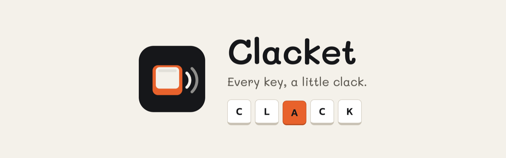
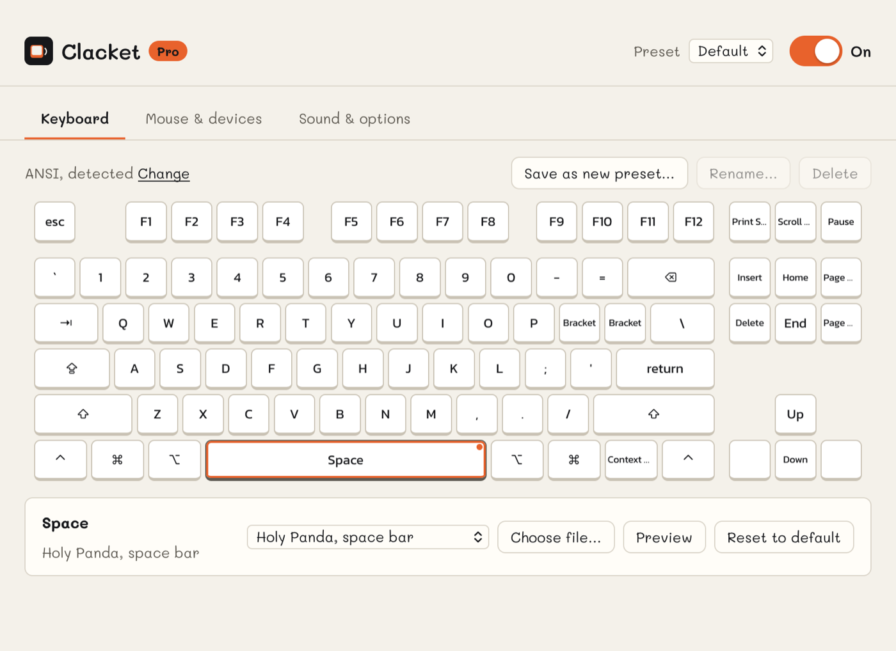
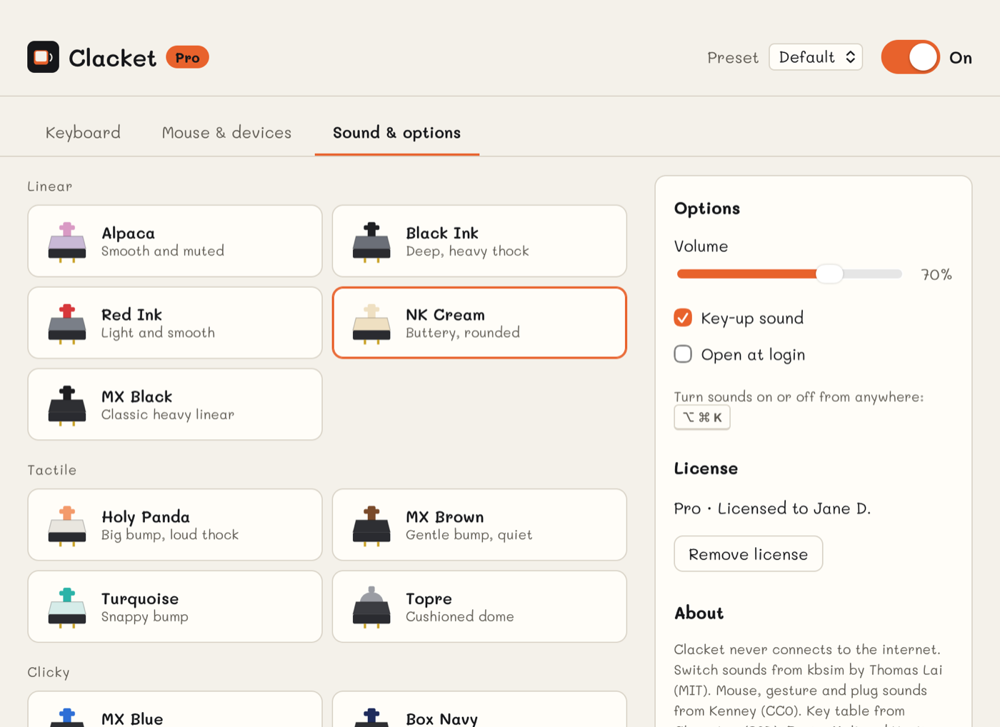
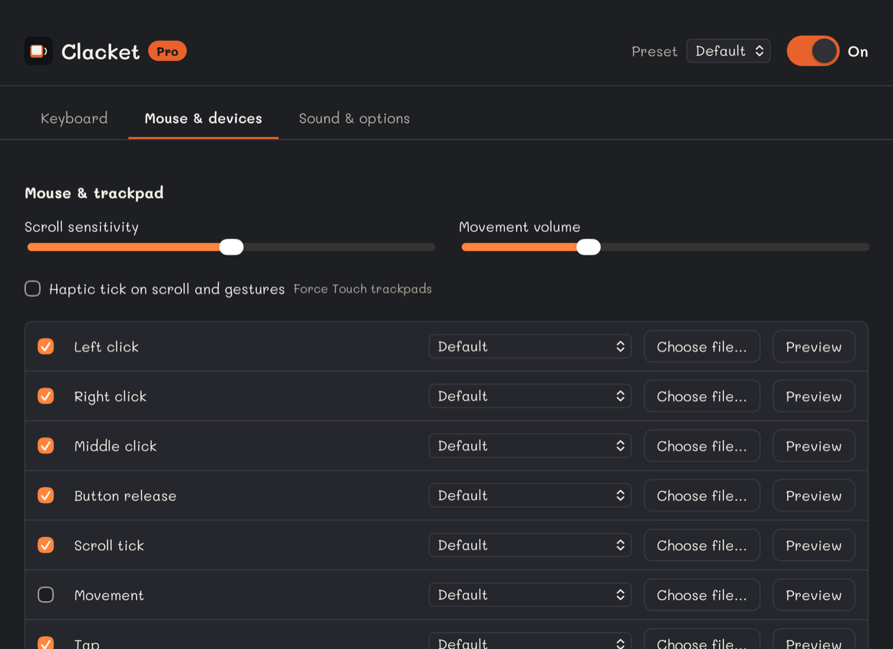
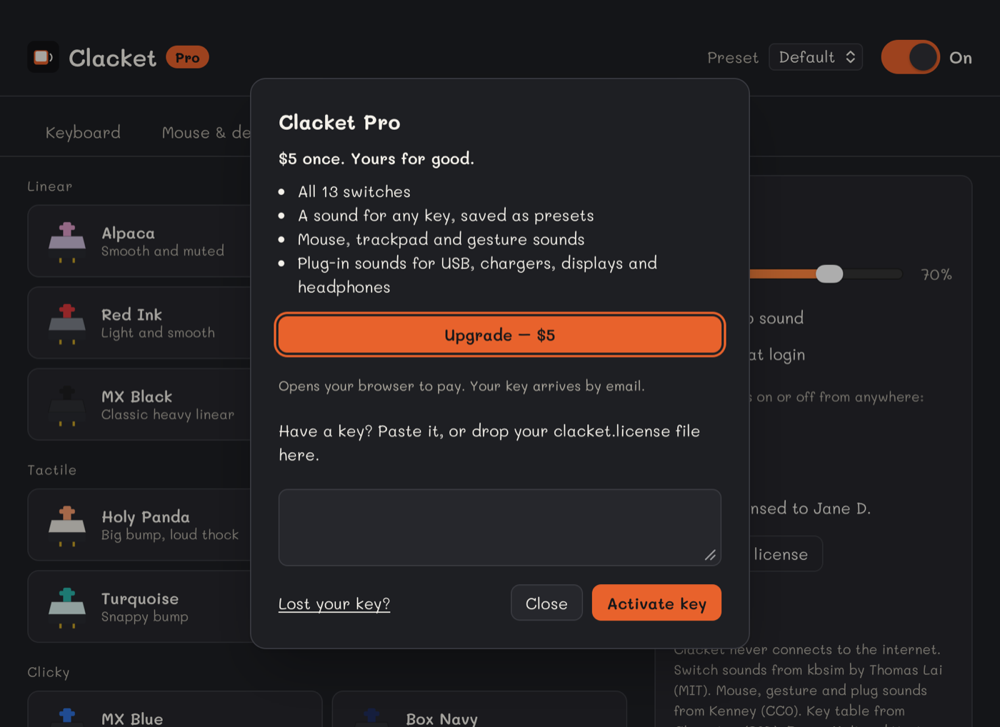

<p align="center">
  <picture>
    <source media="(prefers-color-scheme: dark)" srcset="docs/images/banner-dark.png">
    
  </picture>
</p>

<p align="center">
  Mechanical keyboard sounds for any keyboard, on macOS, Windows and Linux.<br>
  Clacket sits in your menu bar, plays a real switch recording on every key press, and never connects to the internet.<br>
  <a href="https://clacket.th33raphat.dev"><b>clacket.th33raphat.dev</b></a>: try every switch in your browser.
</p>

<p align="center">
  <a href="../../actions/workflows/ci.yml"></a>
</p>

<p align="center">
  
</p>

## What it does

- **Thirteen recorded switches.** Linear (Alpaca, Black Ink, Red Ink, NK Cream, MX Black), tactile (Holy Panda, MX Brown, Turquoise, Topre) and clicky (MX Blue, Box Navy, Blue Alps, Buckling Spring). Space, Enter and Backspace get their own recordings where the switch has them, plus a release sound when you lift the key.
- **A sound for any key.** Click a key on the on-screen keyboard, or press it, and give it any switch's sound or your own MP3 or WAV. Save the whole mapping as a preset and switch presets from the menu bar.
- **Your keyboard, as you see it.** The drawing follows your keyboard's shape (ANSI, ISO or JIS). On macOS the legends come from your input language, so a Thai or AZERTY layout shows its own letters.
- **Mouse, trackpad and plugs.** Clicks, scroll ticks, a soft sound while the pointer moves, taps, swipes and pinches. Sounds when you plug in or unplug a USB drive, phone, keyboard, charger, display, headphones or SD card, with the port (USB-C, USB-A, Thunderbolt) when the system reports it. Force Touch trackpads can give a haptic tick too.
- **Light on your Mac.** The everyday controls live in the menu bar. The settings window only exists while it's open. An idle release build uses about 23 MB of memory and no CPU, and the program itself is about 5 MB with every sound and font built in.

<p align="center">
  
  
</p>

## Free and Pro

Clacket is free to use. Pro costs **$5 once** and is yours for good.

| | Free | Pro |
|---|:---:|:---:|
| NK Cream, MX Brown, MX Blue, Topre | ✓ | ✓ |
| All 13 switches | | ✓ |
| Volume, key-up sound, mute shortcut (⌥⌘K / Ctrl+Alt+K), open at login | ✓ | ✓ |
| A sound for any key, your own sound files, presets | | ✓ |
| Mouse, trackpad and gesture sounds, haptic tick | | ✓ |
| Plug-in sounds | | ✓ |

You pay in your browser and your key arrives by email. Paste it into Clacket, open the `clacket.license` file, or click "Open in Clacket" on the receipt page. Clacket checks the key on your computer.

<p align="center">
  
</p>

## Privacy

Clacket never connects to the internet. It listens to key and mouse events only to play a sound. It doesn't record or store what you type, and it sends nothing anywhere.

This is enforced in the build, not just promised. CI fails if an HTTP or WebSocket library appears in the app's dependencies for any desktop platform, or if socket code shows up in its source (`scripts/check-no-network.sh`). The settings window's content security policy blocks every network request. Upgrading opens your own browser; Clacket itself makes no request.

## Install

Download the installer for your system from [Releases](../../releases/latest): `.dmg` for macOS, `.msi` or `.exe` for Windows, `.deb` or `.AppImage` for Linux.

- **macOS:** the first time Clacket starts, allow it under System Settings → Privacy & Security → **Input Monitoring**, then reopen it. Clacket shows a button that takes you there.
- **Windows:** no setup.
- **Linux:** Clacket reads `/dev/input`, which works on X11 and Wayland. Add yourself to the `input` group (`sudo usermod -aG input $USER`) and log out and back in.

## Website

[clacket.th33raphat.dev](https://clacket.th33raphat.dev) is a static Cloudflare Worker built from `site/`. It has a live demo that plays the same recordings in the browser, and it hosts the installers, since this repo is private. `scripts/build-site.sh` assembles it from the app's sounds, fonts and screenshots and the latest release's installers. Each release redeploys it.

```sh
scripts/build-site.sh && (cd site && npx wrangler deploy)
```

## Build from source

You need Rust (stable), the Tauri CLI (`cargo install tauri-cli --version "^2" --locked`), and on Linux the [Tauri system packages](https://v2.tauri.app/start/prerequisites/#linux).

```sh
cd src-tauri
cargo test                        # unit tests
cargo run -- --settings           # run, opening the settings window
cargo tauri build                 # installers in src-tauri/target/release/bundle
```

The license Worker in `server/` has its own tests: `cd server && npm ci && npm test`.

## How it's put together

```
src-tauri/   the app (Rust + Tauri 2)
  src/input_macos.rs, input_windows.rs, input_linux.rs   key and mouse events from each OS
  src/audio.rs      decodes the active preset once; each key press is a lookup and a mix
  src/devices.rs    plug and unplug events (IOKit, Windows messages, Linux uevents)
  src/license.rs    offline Ed25519 key check
  data/             key table and keyboard shapes, in TOON
  assets/sounds/    switch and effect recordings, packed into the binary at build time
ui/          settings window: plain HTML, CSS and JS, no framework
server/      Cloudflare Worker that sells Pro through Stripe and signs keys
site/        clacket.th33raphat.dev: promo page and browser demo
scripts/     regenerate sounds and the key table; the no-network check
```

The key table isn't written by hand. `scripts/gen-keys.mjs` builds it from Chromium's `dom_code_data.inc`, which maps every key's native code on macOS, Windows and Linux to its web name.

## Releases

Pull request titles follow [Conventional Commits](https://www.conventionalcommits.org) (`feat:`, `fix:`, `perf:`). PRs are squash-merged, so each title becomes one commit on `main`. From those commits, [release-please](https://github.com/googleapis/release-please) keeps a release PR open with the next version number and a changelog of new features and fixes. Merging that PR tags the version, and CI attaches the installers for all three systems to the release.

## Credits

- Switch recordings: [kbsim](https://github.com/tplai/kbsim) by Thomas Lai, MIT license.
- Mouse, gesture and plug sounds: [Kenney](https://kenney.nl), CC0.
- Key code table: [Chromium](https://chromium.googlesource.com/chromium/src/+/main/ui/events/keycodes/dom/dom_code_data.inc), BSD license.
- Fonts: [Mali](https://github.com/cadsondemak/Mali) and [Kanit](https://github.com/cadsondemak/kanit) by Cadson Demak, SIL Open Font License.
